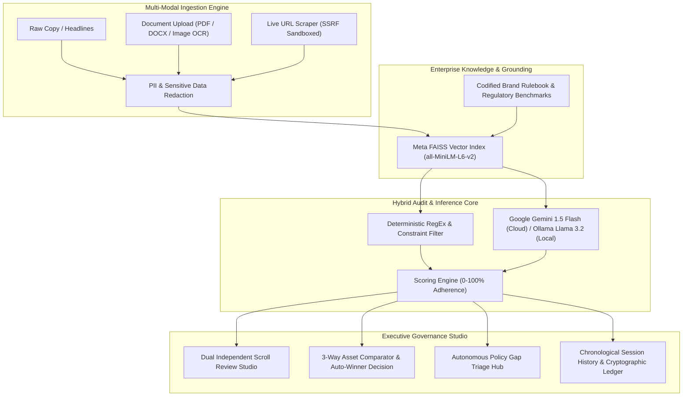

# BrandPrint AI — Autonomous Enterprise Brand Safety & Regulatory Governance

> Real-time multi-modal compliance engine codifying enterprise guidelines, verifying claims with FAISS semantic grounding, and executing 3-way comparative audits.

---

## 📌 Executive Summary

Modern enterprise marketing teams publish thousands of multi-channel campaigns across digital ads, social media, landing pages, and print collateral. However, brand governance remains largely manual, fragmented, and vulnerable to severe regulatory liability:
- **Disparate Rulebooks:** Brand guidelines, legal disclaimers, medical claim policies, and tone handbooks are trapped across lengthy PDFs, SharePoint wikis, and static presentations.
- **Cross-Departmental Contradictions:** Departmental guidelines frequently clash (e.g., product teams promising "99.999% infallible uptime" while legal contracts limit SLAs to 99.9%).
- **Superlative & Regulatory Exposure:** Unsubstantiated superlative claims ("#1 platform", "cheapest solution", "guaranteed results") trigger immediate FTC penalties, ASA investigations, and competitor litigation.
- **Review Bottlenecks:** Human legal and brand safety teams cannot keep pace with high-velocity creative cycles, leading to delayed launches or risky unreviewed assets entering circulation.

**BrandPrint AI** solves this by delivering an autonomous, end-to-end brand safety and regulatory compliance platform. It converts static corporate handbooks into atomic, machine-verifiable constraints, grounds marketing content with vector similarity search (FAISS) and Google Gemini 1.5, executes side-by-side comparative variant scoring, and provides an immutable audit ledger with cryptographic verification.

---

## 🛠️ Architecture & Tech Stack



### Technology Matrix

| Layer | Component | Technologies & Frameworks |
|---|---|---|
| **Frontend UI/UX** | Single Page Application | React 18, TypeScript, Vite, Tailwind CSS, Plus Jakarta Sans, Lucide React |
| **Speech & Audio** | Native Narration Engine | Web Speech Synthesis API (`window.speechSynthesis`) with voice selection & mute toggles |
| **Backend API** | High-Throughput REST Core | Python 3.11+, FastAPI, Pydantic v2, Uvicorn, AnyIO |
| **Database & ORM** | Relational Ledger & Auth | PostgreSQL (Supabase Connection Pooler) via SQLAlchemy 2.0 & Psycopg2 |
| **Vector Grounding** | Semantic Rule Index | Meta FAISS (`faiss-cpu`), HuggingFace `sentence-transformers` (`all-MiniLM-L6-v2`) |
| **LLM Inference** | Primary & Offline Fallbacks | Google Gemini 1.5 Flash (`google-generativeai`), Local Ollama (`llama3.2`), Deterministic Rules |
| **Document & Web Parsing** | Multi-Modal Ingestion | PyMuPDF (`fitz`), `python-docx`, `python-pptx`, Tesseract OCR, BeautifulSoup4, HTTPX |
| **Security & Privacy** | Sandboxed Execution | SSRF private IP validation, regex-based PII masking, JWT bearer auth with HMAC-SHA256 |

---

## 🚀 Key Functional Capabilities

### 1. Multi-Modal Ingestion Engine
Inspect brand compliance across all common creative output channels:
- **Raw Copy & Headlines:** Direct real-time evaluation for email copy, push notifications, headlines, and social posts.
- **Document & Image Upload with OCR:** Extracts text from multi-page PDFs, Word documents, PowerPoint presentations, and promotional posters using multi-modal OCR.
- **Live URL / Web Scraping (SSRF-Sandboxed):** Scrapes public landing pages and extract clean copy. Restricted to concise/short direct URLs with private IP filtering to prevent internal network probing.

### 2. 3-Way Comparative Audits & Best Compliant Variant Decision
Marketing teams benchmark up to 3 campaign variants (`Slot A`, `Slot B`, and `Slot C`) side-by-side:
- **Objective Compliance Scoring:** Calculates baseline adherence scores (0–100%) against company guidelines.
- **Deduction Breakdown:** Categorizes penalties by severity (Critical: -25 pts, Major: -15 pts, Minor: -5 pts).
- **Auto-Winner Coronation:** The engine compares the scoring delta, tone alignment, and violation count to crown the **Best Compliant Variant** accompanied by an executive sign-off rationale.

### 3. Brand Safety Codex & Deterministic Policy Enforcement
Enforces enterprise guidelines across four critical governance categories:
- **Prohibited Superlatives:** Flags unverified claims like *"#1 cloud provider"*, *"cheapest on the market"*, or *"unbeatable solution"*.
- **Medical & Scientific Claims:** Enforces strict disclaimers on health, pharmaceutical, and wellness statements.
- **FTC Substantiation:** Validates that promotional pricing, discount asterisks, and uptime guarantees (99.9% vs. 99.999%) have verifiable references.
- **B2B Tone & Visual Integrity:** Detects colloquial internet slang, passive voice spikes, unapproved hex color codes (`#39FF14`), and WCAG accessibility contrast breaches.

### 4. Autonomous Policy Gap Triage Hub
Identifies emerging marketing claims not covered in current brand rulebooks:
- **Gap Detection:** Distinguishes between *Uncovered Topics* and *Ambiguous Policies*.
- **1-Click Policy Codification:** Review proposed rule revisions, edit criteria in-place, and adopt them directly into the active FAISS vector store.

### 5. Integrated Voice Assistance (Text-to-Speech)
Interactive audio narration powered by the native browser Web Speech API:
- **Welcome Guide & Platform Tour:** Audio narration for first-time visitors walking through each core capability.
- **Live Director Autopilot Bar:** Synchronized voice guidance across all 6 tour steps with rate adjustments (`1x`, `1.5x`, `2x`), step transition syncing, and spacebar pause/resume.
- **Persistent User Mute Toggle:** Dedicated header and bar buttons (`Voice ON` / `Voice OFF`) with state persistence in `localStorage`.

### 6. Chronological Audit History & Ledger Replay
Maintains an immutable historical record matching modern ChatGPT and Gemini session interfaces:
- **Chronological Date Grouping:** Automatic bucketing into *Today*, *Yesterday*, *Previous 7 Days*, and *Earlier (Month Year)*.
- **Precise Badges:** Displays exact timestamps (`DD MMM YYYY • hh:mm A`) alongside relative time tags.
- **1-Click State Replay:** Click any session card to restore previous inputs, extracted OCR copy, and AI finding highlights.

---

## 🔒 Confidentiality & PII Protection

To protect trade secrets, unreleased campaign names, customer identifiers, and sensitive operational metrics, BrandPrint AI includes a pre-inference data sanitization layer:

```
[Raw Marketing Input]
         │
         ▼
[Regex & Named Entity Masker]
   ├── Customer Names & Emails ──> [REDACTED_USER_XXXX]
   ├── Proprietary SKU Codes  ──> [INTERNAL_SKU_REF]
   ├── Financial Figures      ──> [METRIC_REDACTED]
   └── API Keys / Tokens      ──> [AUTH_SECRET_OMITTED]
         │
         ▼
[Sanitized Payload Sent to Gemini / Local LLM]
         │
         ▼
[Output De-Anonymized for Authorized Workspace Users]
```

- **Transparent Audit Logs:** Shows compliance leads exactly what was masked prior to network transmission.
- **Deterministic Offline Processing:** Confidential documents can be evaluated entirely on-premise using Ollama and local FAISS vector embeddings without external API calls.

---

## 📡 Core API Reference

| Endpoint | Method | Description |
|---|---|---|
| `/api/system-status` | `GET` | Lightweight system health & round-trip latency probe (`healthy`, `state: warm`). |
| `/health` | `GET` | Detailed operational telemetry, database connection status, and CORS origins. |
| `/api/auth/login` | `POST` | Authenticate user credentials and issue JSON Web Token (JWT). |
| `/api/guidelines` | `GET` | Retrieve active brand rules, categories, and severity levels. |
| `/api/guidelines/upload-document` | `POST` | Upload and parse PDFs/DOCX with automated rule extraction (`preview_only=true` supported). |
| `/api/reviews` | `POST` | Execute full multi-modal audit on text copy, OCR image, or web URL. |
| `/api/reviews/compare` | `POST` | Benchmark Slots A, B, and C with automated winner decision and penalty matrix. |
| `/api/guidelines/check-contradictions` | `POST` | Autonomous pairwise contradiction audit across active brand rulebook. |
| `/api/guidelines/gaps` | `GET` | Retrieve ungrounded claims and policy ambiguities for triage. |
| `/api/history` | `GET` | Retrieve past audit sessions with search filters, SHA-256 digests, and pagination. |

---

## 🗺️ Product Roadmap (2026 - 2027)

- [x] **Phase 1: Core Multi-Modal Audit & Contradiction Detection Engine**
  - High-precision deterministic regex rules combined with Google Gemini 1.5 Flash.
  - Multi-document parser (PDF, DOCX, PPTX) and SSRF-sandboxed web scraper.
  - Dual independent scroll Review Studio with evidence highlight cards.

- [x] **Phase 2: 3-Asset Comparison Engine with Guideline Scoring & Voice Narration**
  - 3-slot comparative evaluation matrix with automatic winner coronation.
  - Native Web Speech Synthesis integration across Onboarding Guide and Live Director bar.
  - Chronological audit history with 1-click session restoration.

- [ ] **Phase 3 (Q1 2027): Direct Figma & Adobe Creative Cloud Automated Design Plugin**
  - Live canvas auditing inside Figma to check typography, layer contrast, and color palette codes.
  - Adobe InDesign & Illustrator extension for print collateral pre-flight sign-offs.

- [ ] **Phase 4 (Q2 2027): Slack & MS Teams Webhook Bots for Automated Campaign Sign-Offs**
  - Instant marketing campaign link review via `/brandprint check <url>` slash commands.
  - One-click approval workflows for designated legal reviewers inside chat channels.

- [ ] **Phase 5 (Q3 2027): Enterprise Single Sign-On (SAML / Okta) & Localized Legal Codices**
  - Enterprise SSO integration (Okta, Azure AD, Ping Identity).
  - Out-of-the-box regulatory packs: EU AI Act transparency rules, HIPAA healthcare claims, and UK ASA / Indian ASCI advertising codes.

---

## ⚙️ Local Development Setup

### Prerequisites
- **Python 3.11+** installed and added to PATH
- **Node.js 18+** and `npm`
- **Git**

### 1. Clone the Repository
```bash
git clone https://github.com/granthali-git/BrandPrint-AI.git
cd BrandPrint-AI
```

### 2. Backend Setup (Port 8001)
```bash
# Navigate to backend directory
cd backend

# Create and activate Python virtual environment
python -m venv .venv

# Windows PowerShell:
.venv\Scripts\Activate.ps1
# macOS / Linux:
source .venv/bin/activate

# Install dependencies
pip install -r requirements.txt

# Launch FastAPI backend server on port 8001
uvicorn app.main:app --reload --port 8001
```

> Backend Swagger documentation will be available at: `http://localhost:8001/docs`  
> Live health endpoint: `http://localhost:8001/health`

### 3. Frontend Setup (Port 5173)
Open a new terminal window:
```bash
# Navigate to frontend directory
cd frontend

# Install dependencies
npm install

# Launch Vite development server on port 5173
npm run dev
```

> Open your browser at: `http://localhost:5173`

---

## 🧪 Default Test Credentials

For local development and testing:
- **Email:** `tester@brandprint.ai` (or `admin@brandprint.ai`)
- **Password:** `Password123!`
- **Role:** Brand Safety Admin / Compliance Lead

---

## 📄 License & Intellectual Property

Enterprise Commercial Evaluation — All Rights Reserved © 2026 BrandPrint AI.
Built with Google Gemini, Meta FAISS, and FastAPI.
